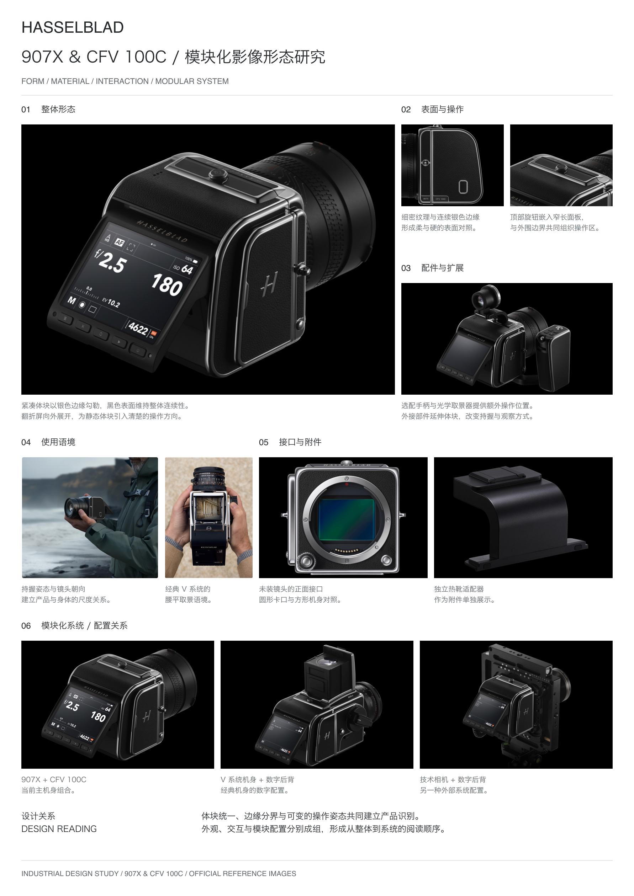
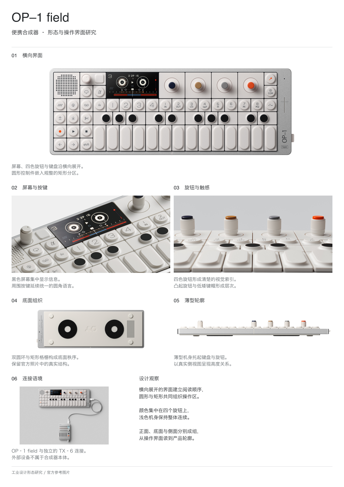
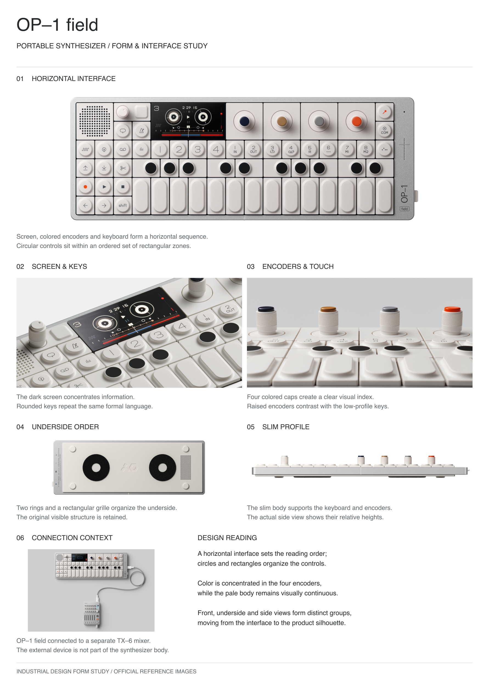

# 工业设计展板构图 Skill

先规划图文关系，再交给生图模型。根据产品形态和现有素材组织构图，检查细间距、跨区对齐与图注基线。

**中文、英文两个独立技能。输出构图引导包，包含线框、取景说明和生图提示词。**

[展示页](https://19825223903tsc-cmd.github.io/industrial-board-layout/) · [English introduction](README.en.md)

## 下载与安装

- [中文版 v14](downloads/industrial-board-layout-zh-v14.zip)：中文标点禁则、混排、字体测量与短尾行。
- [English v14](downloads/industrial-board-layout-en-v14.zip)：按词换行、长型号、大小写、孤词与英文图注。

解压所需 ZIP，将其中完整的 `industrial-board-layout-zh` 或 `industrial-board-layout-en` 文件夹放入 `~/.agents/skills/`。技能目录内应直接包含 `SKILL.md`，避免多套一层。没有该父目录时先创建。脚本渲染需要 Python 3、Pillow 和可用的对应语言字体；自带脚本先检查字体，所需依赖见技能说明。不附带模型额度或字体授权。

[Codex 官方技能说明](https://learn.chatgpt.com/docs/build-skills)

## 调用示例

上传真实产品图后，根据目标语言选一个：

```text
调用 $industrial-board-layout-zh。
用我上传的产品图规划 A3 竖版中文展板。
重点展示形态、细节与使用关系。缺少依据就精简模块。
完成五轮检查后，输出构图线框、取景说明和生图提示词。
暂不生成最终展板。
```

```text
Use $industrial-board-layout-en.
Plan an A3 portrait board in English using my product photos.
Emphasize form, details and use. Omit unsupported modules.
Complete all five review passes, then provide the wireframe,
source framing notes and image-generation prompt.
Do not generate the final board yet.
```

## 展示案例

下图均为**原图排版校样**，用于检查构图和实际图文落位，不是已验收的生图结果。

| 哈苏 A3 竖版 | OP–1 中文 | OP–1 English |
|---|---|---|
|  |  |  |

## 发布材料在哪

| 目录 | 内容 |
|---|---|
| [小红书账号](小红书账号/) | 6 张中文图、可复制正文、置顶评论、分享链接、PNG 与可编辑 SVG |
| [X推送](X推送/) | 4 张英文图、单条推文、4 条串文、英文 alt text、PNG 与可编辑 SVG |
| [skills](skills/) | 两个独立技能的完整源码、规则和测试 |
| [downloads](downloads/) | 两个可独立安装的 v14 ZIP |
| [examples](examples/) | 完整原图校样 |
| [docs](docs/) | GitHub Pages 展示页与下载入口 |

旧版本和失败的生图测试保留在原工作目录，不混入当前发布包。

## 检查范围与限制

两个语言包各有 45 项单元测试，拆分时已通过；既有 OP1 两版线框回归通过。生图前按证据、几何、原图取景、排字、整体密度完成五轮审查；实际生图后，再做构图、产品、文字三轮复核。脚本通过不等于审美或生图结果通过，尚未证明下游模型能稳定遵循所有约束。

素材少就精简内容，不凭空补造产品结构、内部机构、功能参数或研发过程。照片与品牌说明见 [NOTICE](NOTICE.md)。
